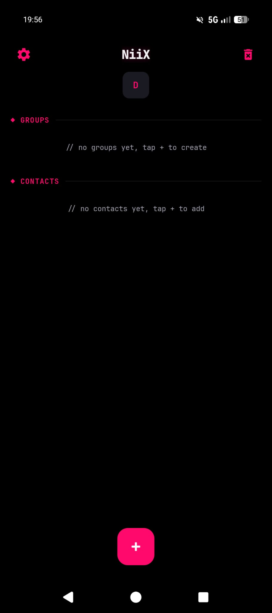
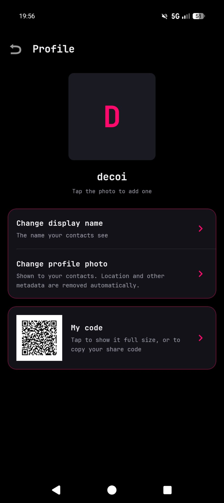
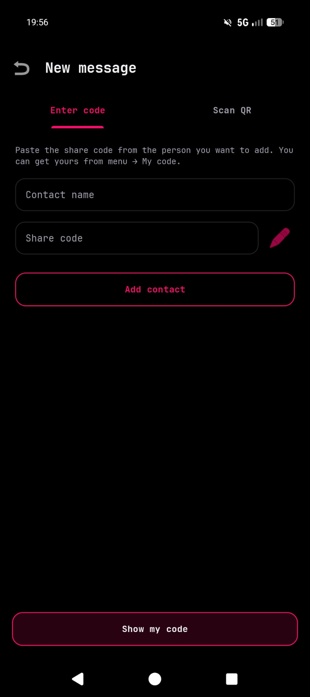
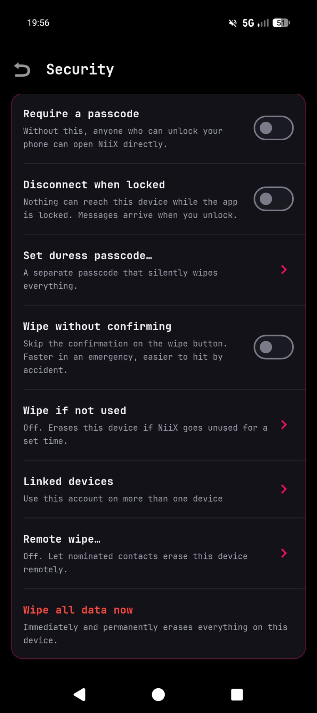
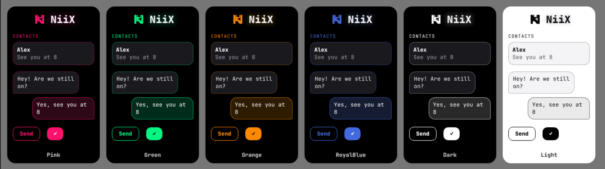

<h1 align="center">
  
  
  
</h1>

A private messenger for Android that runs entirely over Tor. No phone number, no email, no
account, and no NiiX server: your phone talks straight to the phones of the people you message, so
nobody in the middle sees your messages or who you're talking to.

- **End-to-end encrypted** with the Signal protocol, including a post-quantum key exchange, for
  messages, groups, photos, files and voice messages
- **Voice calls, only if both of you allow them**, with verified contacts only. Off for everyone
  until you turn them on for someone. Calls go over Tor too, so neither of you learns the
  other's IP address
- **Over Tor, phone to phone.** Neither side learns the other's IP address, and there's no
  directory to look anyone up in: you swap codes in person or by QR
- **Messages reach people who are offline**, waiting sealed on public Nostr relays that can't read
  them or tell who they're for
- **Locked down on the phone.** Everything is stored encrypted under your passcode and the phone's
  secure hardware, and messages arrive blurred until you tap them
- **For when things go wrong:** a duress passcode that wipes and opens a decoy account, a wipe
  button, remote wipe by contacts you choose, and an optional wipe if the app goes unused
- **Disappearing messages**, with a timer either side can set
- **Up to five linked devices** on one account
- **Encrypted backups** you make yourself, and signed updates downloaded over Tor
- **12 languages:** English, German, French, Spanish, Italian, Russian, Persian, Chinese, Arabic,
  Japanese, Thai and Korean

Requires Android 10 or newer. Download the APK from
[Releases](https://github.com/techniixdotcom/niix-messenger/releases); the app checks for updates
itself after that.

How it works, how to build it, and the full documentation:
[`docs/HOW-IT-WORKS.md`](docs/HOW-IT-WORKS.md).

## What it can't do

- **It hasn't had a professional security audit**, and it hasn't been used at scale. It's built
  carefully, but that isn't a guarantee there are no mistakes.
- **It can't protect a compromised phone.** Spyware on the phone can see what you see.
- **It can't stop the other person** screenshotting, photographing or copying what you send,
  disappearing messages included.
- **Calls are voice only and one to one**, and Tor adds about a second of delay. They only ring
  while NiiX is unlocked.
- **Android only**: no iPhone or desktop app.
- **Offline delivery needs you and a contact to have been online together once** before it works.
- **Tor is slower than the normal internet**, and keeping the connection open uses some battery.
  Android, and Samsung phones especially, may stop NiiX in the background unless you let it run.
- **A new linked device gets your contacts and groups, not your message history.**
- **Relays can see that someone is using NiiX**, though not who or with whom.
- **Groups use a protocol of NiiX's own** that hasn't been formally analysed, and group signatures
  aren't post-quantum yet.
- **The inactivity wipe can't count time the phone spends switched off** with its clock wound
  back. Winding the clock back while it's on doesn't stop it.

The full list, and what NiiX does protect against, is in
[`docs/THREAT-MODEL.md`](docs/THREAT-MODEL.md).

## The Look

  
  
  
  

## Theme Choices

  

## Licence

NiiX is free software under the GNU General Public License version 3: you can use, study, change
and share it, and anything you distribute built from it must stay free under the same terms. It
comes with no warranty. The full text is in [`LICENSE`](LICENSE).

  Peace and Love 
  techniix / cuteLiLi / QuacK / decoi

